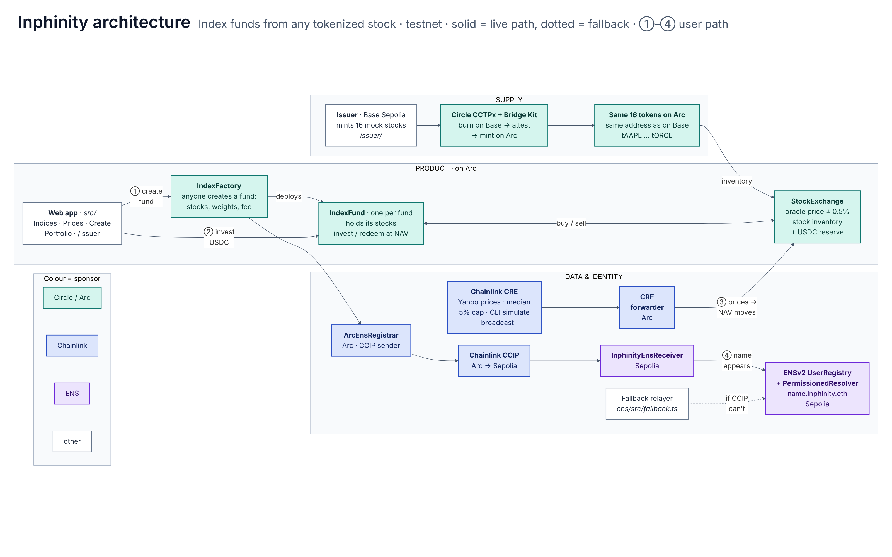

# Inphinity

**Index funds from any tokenized stock: US today, Indian next.**

Anyone can build an index fund from tokenized stocks on Arc and invest in it with USDC. Fund shares are minted
and redeemed at NAV, prices come from a Chainlink CRE workflow, and every fund gets an ENS name.

**Live app:** https://www.inphinity.trade (Arc Testnet)



More detail: [`docs/ARCHITECTURE.md`](docs/ARCHITECTURE.md) (diagram source, the user path and what each piece does).

## How it works

**Supply.** An issuer deploys 16 mock US stocks (tAAPL … tORCL) on Base Sepolia as Circle CCTP cross-chain tokens.
Circle CCTPx moves them to Arc by burning on Base, attesting and minting on Arc, so the token on Arc is the
issuer's own token at the same address, not a wrapped IOU. The issuer sends stock into the exchange's inventory
from the issuer console (`/issuer`, built with Circle Bridge Kit) or the `issuer/` scripts.

**Prices.** A Chainlink CRE workflow reads the listed stocks from the `StockExchange`, fetches Yahoo Finance prices
with median consensus and writes a signed report through the CRE forwarder. Each update can move a price at most
5%. The exchange buys and sells against its inventory and a USDC reserve at that price ± 0.5%.

**Funds.** `IndexFactory` lets anyone create a fund: 2–10 stocks, weights, and a management fee of up to 2% a year.
Each `IndexFund` is an ERC-20 share token. `invest` buys every stock at its weight from the exchange and mints
shares at NAV; `redeem` sells the holder's slice back. The fund contract holds its stocks, and NAV is those stocks at
the exchange's mid price plus idle USDC, so it moves with every CRE report. The fee is taken as new shares
(dilution); there is no admin withdraw.

**Names.** When a fund is created, `ArcEnsRegistrar` sends a Chainlink CCIP message from Arc to
`InphinityEnsReceiver` on Sepolia, which registers `<label>.inphinity.eth` in an ENSv2 `UserRegistry` with a
`PermissionedResolver`. The name resolves to the fund's Arc address and carries its weights, fee and creator.
Naming never blocks fund creation; a fallback relayer (`ens/src/fallback.ts`) names a fund only when CCIP didn't.

## Try it

1. Add **Arc Testnet** to your wallet: chain ID `5042002`, RPC `https://rpc.testnet.arc.network`, explorer
   https://testnet.arcscan.app. USDC is the gas token. The app also offers to switch your wallet for you.
2. Get test USDC at https://faucet.circle.com (choose Arc Testnet).
3. Open https://www.inphinity.trade, pick a fund on **Indices** and invest **at least 1 USDC**, or build your own on
   **Create**. Your shares show up on **Portfolio**, and the fund's ENS profile at `/<label>.inphinity.eth`
   (for example `/bchip.inphinity.eth`).

## Contracts

| Contract | Network | Address |
|---|---|---|
| StockExchange | Arc Testnet | [`0x93662de514b981f8c7bf97085e359e0f18034804`](https://testnet.arcscan.app/address/0x93662de514b981f8c7bf97085e359e0f18034804) |
| IndexFactory | Arc Testnet | [`0x9fa4034efb237a7c154adea20b1ccfa0cd538b11`](https://testnet.arcscan.app/address/0x9fa4034efb237a7c154adea20b1ccfa0cd538b11) |
| ArcEnsRegistrar (CCIP sender) | Arc Testnet | [`0x39437a4f9c2ed49c5c3310681d440b26a0cb23cd`](https://testnet.arcscan.app/address/0x39437a4f9c2ed49c5c3310681d440b26a0cb23cd) |
| CRE forwarder | Arc Testnet | [`0x6E9EE680ef59ef64Aa8C7371279c27E496b5eDc1`](https://testnet.arcscan.app/address/0x6E9EE680ef59ef64Aa8C7371279c27E496b5eDc1) |
| InphinityEnsReceiver (CCIP receiver) | Sepolia | [`0x95b9aaba9fc5209e68afe1686d80a69fa03bb23f`](https://sepolia.etherscan.io/address/0x95b9aaba9fc5209e68afe1686d80a69fa03bb23f) |
| `inphinity.eth` UserRegistry | Sepolia | [`0xefC414eb999907620AbdA991decD2BD22aBb9Ac1`](https://sepolia.etherscan.io/address/0xefC414eb999907620AbdA991decD2BD22aBb9Ac1) |
| PermissionedResolver | Sepolia | [`0x26E1611FD97133dfaef7b562D88528e8C1649ae2`](https://sepolia.etherscan.io/address/0x26E1611FD97133dfaef7b562D88528e8C1649ae2) |
| tAAPL (example stock, same address on both chains) | Arc Testnet / Base Sepolia | [`0x4572E4D21199deA83a5E069361871512c31a3bBd`](https://testnet.arcscan.app/address/0x4572E4D21199deA83a5E069361871512c31a3bBd) ([Base](https://sepolia.basescan.org/address/0x4572E4D21199deA83a5E069361871512c31a3bBd)) |

Each fund is its own `IndexFund` contract, deployed by the factory. All 16 stock addresses are in
[`issuer/deployments.json`](issuer/deployments.json); ABIs are in [`contracts/contract-metadata/`](contracts/contract-metadata/).

## Repo map

| Path | What's there |
|---|---|
| `contracts/` | Core contracts: StockExchange, IndexFactory, IndexFund, SIPManager, with Foundry tests (written, tested and deployed with Arc Studio) |
| `contracts/ccip/` | ArcEnsRegistrar and InphinityEnsReceiver: fund naming over Chainlink CCIP |
| `cre/` | Chainlink CRE price workflow (`price-feed/`) and its runbook |
| `ens/` | ENSv2 registry setup for `inphinity.eth`, CCIP deployment scripts and the fallback relayer |
| `issuer/` | CCTP issuance on Base Sepolia, bridging to Arc and exchange setup scripts |
| `src/` | Web app (React, Vite, wagmi, viem) |
| `docs/` | Architecture, build log, product decisions, NAV maths |

## Run locally

```bash
bun install
bun run dev                 # web app on Arc Testnet

bun run contracts:build     # forge build
bun run contracts:test      # forge test (145 tests)
```

The CRE workflow and the ENS fallback relayer have their own runbooks: [`cre/README.md`](cre/README.md) and
[`ens/README.md`](ens/README.md).

## Built with

- **Arc Studio** wrote, tested and deployed the core contracts (StockExchange, IndexFactory, IndexFund, SIPManager).
- **Circle CCTPx + Bridge Kit** for the stock tokens' Base Sepolia → Arc route.
- **Chainlink CRE** for stock prices and **Chainlink CCIP** for fund naming from Arc to Sepolia.
- **ENSv2** (UserRegistry, PermissionedResolver) on Sepolia for the `inphinity.eth` fund registry.

## AI use

The core contracts were built in Arc Studio; the rest was built with Claude Code sessions, with product decisions,
approvals and merges by a human. [`docs/BUILD_LOG.md`](docs/BUILD_LOG.md) has the timestamped timeline and a
"Who built what" table. [`docs/DECISIONS.md`](docs/DECISIONS.md) records the product and design decisions and the
options we rejected.

## Limits

- **Mock tokens, not securities.** The 16 stocks are testnet tokens that track US share prices. They carry no
  ownership or rights.
- **CRE runs as a CLI simulation** (`cre workflow simulate --broadcast` on a loop), not a deployed DON workflow, and
  the exchange uses a mock forwarder. Anyone running the simulator could push prices, bounded by the 5% cap.
- **The exchange's `buy`/`sell` are public onchain.** The app is index-only (no single-stock trading in the UI), but
  the contract doesn't restrict callers to registered funds yet.
- **Exchange inventory** is stocked for 8 of the 16 stocks; Create offers only stocks with inventory.
- **Testnet only:** Arc Testnet, Base Sepolia and Sepolia.
