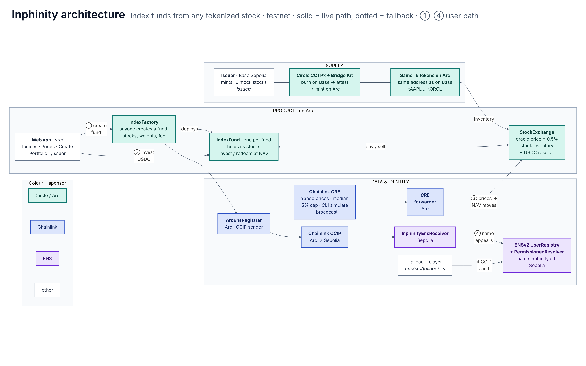
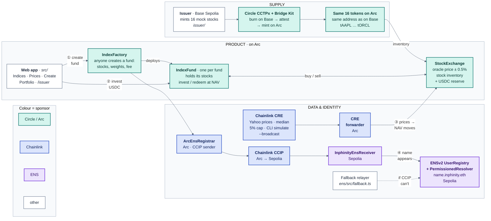

# Inphinity architecture

Inphinity lets anyone build an index fund from tokenized stocks on Arc Testnet and invest in it with USDC.
The system has three layers:

1. **Supply:** how stocks reach Arc.
2. **Product:** funds and the exchange they trade with.
3. **Data & identity:** prices and names.

Colours mark the sponsor technology: Circle / Arc (green), Chainlink (blue), ENS (purple). ① to ④ is the path
a user sees.

## The user path

| Step | What happens | Where |
|---|---|---|
| ① Create fund | The web app calls `IndexFactory.createIndex` with 2–10 stocks, weights and a fee of up to 2% a year. The factory deploys a new `IndexFund`. | `src/pages/Create.tsx`, `contracts/IndexFactory.sol` |
| ② Invest | The investor sends USDC (at least 1). The fund buys each stock at its weight from the `StockExchange`, holds the tokens, and mints shares at NAV. | `src/pages/Indices.tsx`, `contracts/IndexFund.sol` |
| ③ NAV moves | A Chainlink CRE workflow writes new prices to the exchange through the CRE forwarder. The fund's NAV is its stocks at the exchange's mid price plus idle USDC, so it moves with every report. | `cre/price-feed/main.ts`, `StockExchange.onReport` |
| ④ Name appears | In the same transaction as ①, the factory asks `ArcEnsRegistrar` to name the fund. A Chainlink CCIP message reaches `InphinityEnsReceiver` on Sepolia, which creates `<label>.inphinity.eth`. | `contracts/ccip/`, `ens/` |

## Pieces

| Piece | What it does | Code |
|---|---|---|
| Issuer | Deploys each mock stock on Base Sepolia as a Circle CCTP cross-chain token; the Arc copy has the same address. Mints and sends stock into exchange inventory. | `issuer/`, `src/pages/Issuer.tsx` (`/issuer`) |
| Circle CCTPx + Bridge Kit | Moves a stock from Base Sepolia to Arc: burn on Base, Circle attests, mint on Arc. No wrapped token and no locked pool. | `issuer/scripts/`, `src/lib/bridge.ts` |
| StockExchange | Sells and buys stocks against its own inventory and a USDC reserve, at the oracle price ± 0.5%. Accepts prices only from the CRE forwarder; each update may move a price at most 5%. | `contracts/StockExchange.sol` |
| IndexFactory | Creates funds and asks the registrar to name them. Naming never makes fund creation revert. | `contracts/IndexFactory.sol` |
| IndexFund | One ERC-20 share token per fund. Holds its stocks; `invest` and `redeem` at NAV; `investInKind` accepts stocks directly. No admin withdraw. | `contracts/IndexFund.sol` |
| Chainlink CRE workflow | Reads the listed stocks from the exchange, fetches Yahoo Finance prices with median consensus, clamps to the 5% cap and writes a signed report. Runs as a CLI simulation with `--broadcast`. | `cre/price-feed/` |
| CRE forwarder | Delivers the CRE report to `StockExchange.onReport`. | `cre/README.md` |
| ArcEnsRegistrar | CCIP sender on Arc, called by the factory. Skips naming (and emits `NamingSkipped`) if it can't pay the CCIP fee. | `contracts/ccip/ArcEnsRegistrar.sol` |
| Chainlink CCIP | Carries the naming message from Arc to Sepolia (9M gas limit). | `contracts/ccip/` |
| InphinityEnsReceiver | CCIP receiver on Sepolia. Registers the label and writes the fund's records. | `contracts/ccip/InphinityEnsReceiver.sol` |
| ENSv2 UserRegistry + PermissionedResolver | The `inphinity.eth` registry: each fund name resolves to its Arc address (ENSIP-11 coin type `2152525650`), with weights, fee and creator as text records. | `ens/`, `ens/DESIGN.md` |
| Fallback relayer | Names a fund directly on Sepolia only when CCIP didn't (naming skipped, or a message stuck for 2 h). Dotted in the diagram. | `ens/src/fallback.ts`, `ens/fallback-loop.sh` |
| Web app | React + wagmi. Indices (home), Prices (read only), Create, Portfolio, the issuer console at `/issuer`, and ENS fund profiles at `/<label>.inphinity.eth`. | `src/` |

Solid arrows are live paths. The dotted arrow is the fallback.

## Mermaid source

The PNG is rendered from [`architecture.mmd`](architecture.mmd) with mermaid 11.4.1 in headless Chromium
(1600×1000 at 2×).

