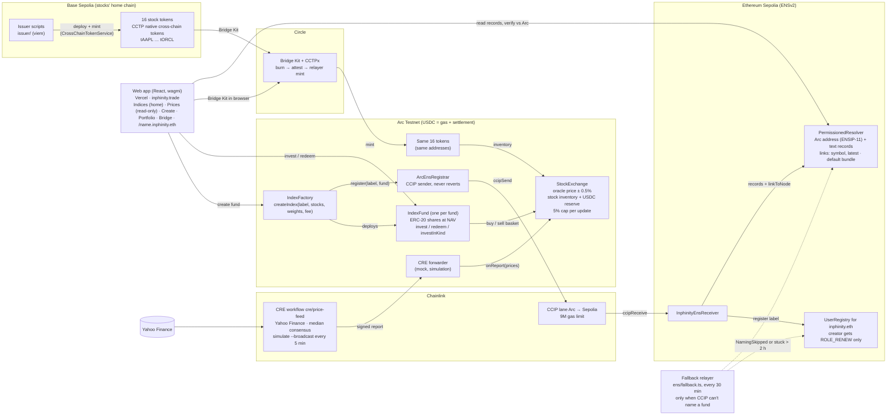

# Inphinity architecture

## Legend

| Piece | What it does | Code |
|---|---|---|
| Issuer scripts | Deploy each stock on Base Sepolia as a Circle CCTP cross-chain token; Circle creates the Arc twin at the same address; bridge stock into exchange inventory | `issuer/` |
| Bridge Kit | In-app Base → Arc bridging: approve, burn on Base, Circle attests, Circle's relayer mints on Arc (no Arc gas). ~15–20 min | `src/lib/bridge.ts`, `src/pages/Bridge.tsx` |
| StockExchange | Oracle-priced inventory exchange in USDC. Accepts prices only from the CRE forwarder when `priceSource = Feed` | `contracts/StockExchange.sol` (Arc Studio) |
| CRE workflow | Reads listed stocks from the exchange, fetches Yahoo prices with median consensus, clamps to the 5% cap, writes a signed report | `cre/price-feed/main.ts` |
| IndexFactory / IndexFund | Anyone creates a fund (2–10 stocks, weights, fee ≤ 2%/yr); shares minted/burned at NAV; investor pays the spread | `contracts/IndexFactory.sol`, `contracts/IndexFund.sol` (Arc Studio) |
| ArcEnsRegistrar → CCIP → InphinityEnsReceiver | Names each fund `<label>.inphinity.eth` on Sepolia inside the fund-creation tx; never blocks fund creation | `contracts/ccip/` |
| UserRegistry + PermissionedResolver | Our ENSv2 subname registry and resolver; Enhanced Access Control keeps creators from repointing names | `ens/`, `ens/DESIGN.md` |
| Fallback relayer | Names a fund only when CCIP didn't (skipped for fee, or stuck > 2 h); retries stored receiver failures | `ens/src/fallback.ts` |
| Web app | React + wagmi on Vercel, index-only (no single-stock buy/sell in the UI); the ENS profile page joins ENS identity with live NAV from Arc and verifies them | `src/` |

PNG export (for slides and the submission form): [`architecture.png`](architecture.png).

Solid arrows are live paths; dotted arrows are the fallback. Addresses are in [`SUBMISSION.md`](SUBMISSION.md#6-contract-addresses).
